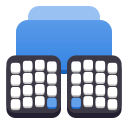
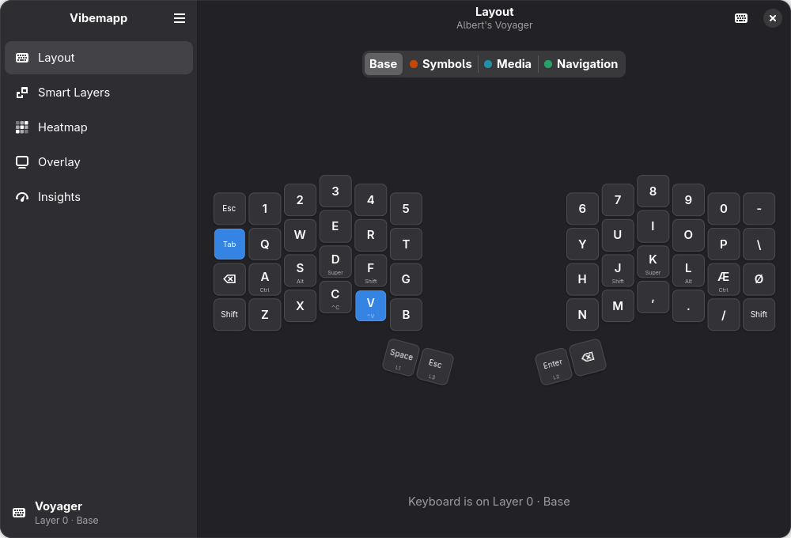
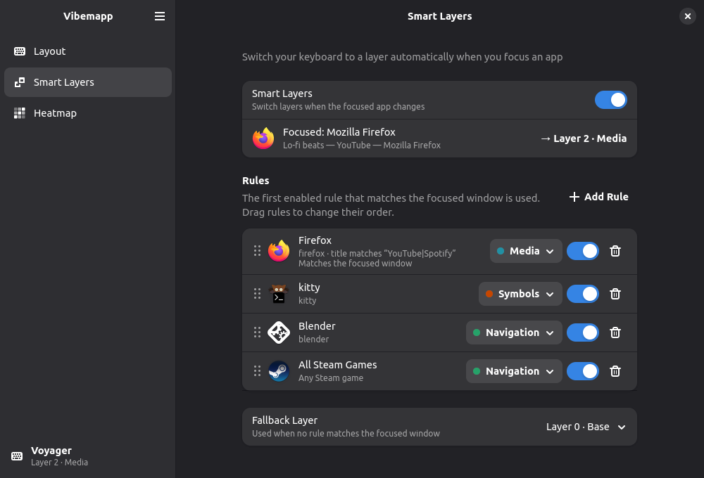
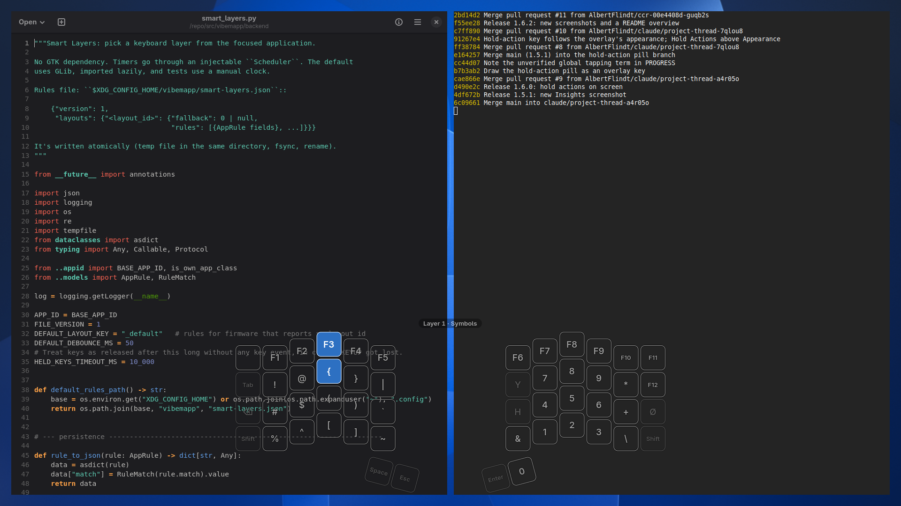
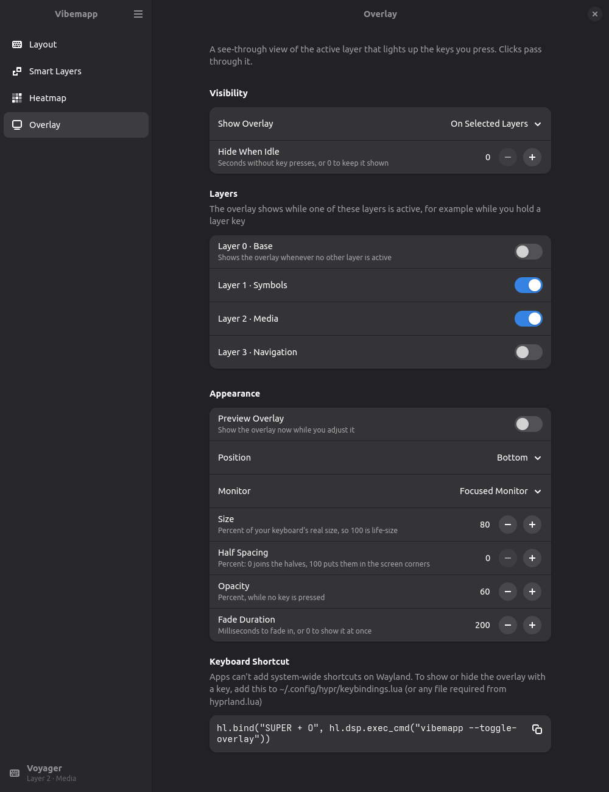
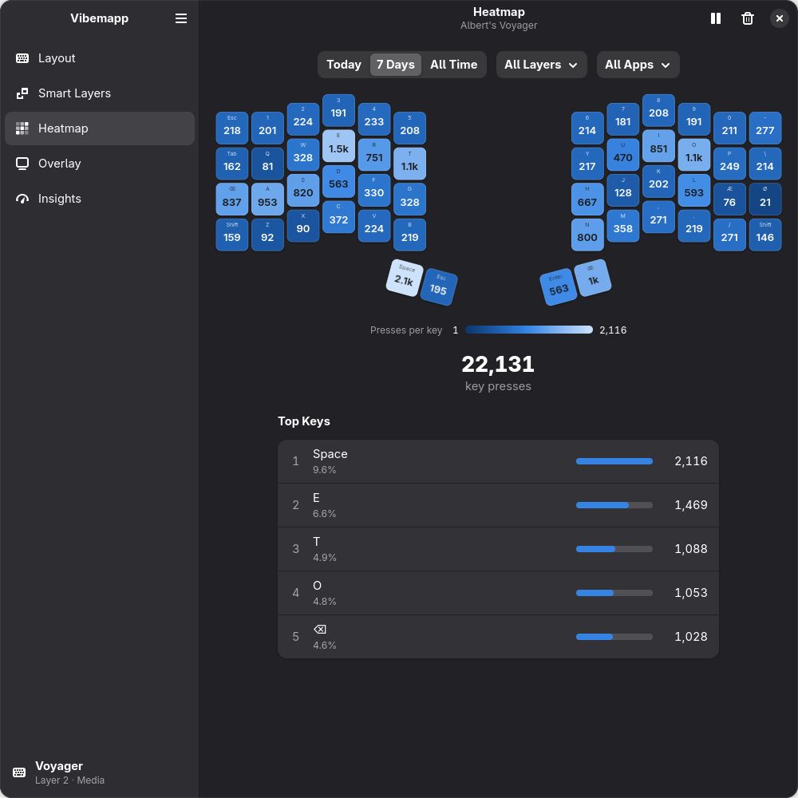
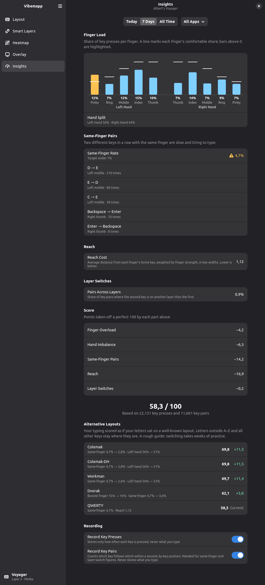
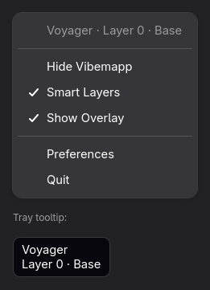

<p align="center">
  
</p>

<h1 align="center">Vibemapp</h1>

<p align="center">
  A GNOME/libadwaita take on ZSA Keymapp for Linux, written in Python with PyGObject.<br>
  See your Oryx layout live, and let your keyboard switch layers when you switch apps.
</p>

<p align="center">
  <a href="https://github.com/AlbertFlindt/vibemapp/releases/latest"></a>
  <a href="https://github.com/AlbertFlindt/vibemapp/actions/workflows/ci.yml"></a>
  <a href="#license"></a>
</p>

<p align="center">
  <a href="#features">Features</a> ·
  <a href="#requirements">Requirements</a> ·
  <a href="#installation-arch-linux">Installation</a> ·
  <a href="#running-from-source">Running from source</a>
</p>

<p align="center">
  
</p>

| Feature | What it does |
|---|---|
| **Live Layout** | Your Oryx layout, the active layer and the keys you press, live. |
| **Smart Layers** | Switches the keyboard's layer when the focused app changes (Hyprland). |
| **Overlay** | A see-through, click-through view of the layer you're on. |
| **Heatmap and Insights** | Opt-in key-press counts and finger load. Counts only, never what you type. |
| **Tray Icon** | Keeps Smart Layers running with the window closed. |

Vibemapp never flashes firmware or writes to the keyboard's EEPROM.

## Features

### Live Layout

Shows your Oryx layout with the keyboard's active layer and the keys you press, live.
Transparent keys show the key they fall through to. Hover a key for details.

### Smart Layers

Switches your keyboard's layer when the focused app changes. Rules can match one app, a
window-class regex or all Steam games, with a fallback layer for everything else. Needs Hyprland.



### Overlay

A see-through, click-through drawing of the active layer that lights up the keys you press.
In "selected" mode it shows only while one of the layers you picked is active: hold your
symbols layer key and it appears, release it and it fades out. "Always" shows it on every
layer. It never takes focus, and it follows the focused monitor or stays on a fixed one.

<p align="center">
  
</p>

- **Size** is a percentage of your keyboard's real size, so it looks the same on every
  monitor (computed from each monitor's physical width).
- **Half spacing** moves the keyboard halves apart, up to the two corners of the screen edge.
- **Toggle** it from the tray ("Show Overlay"), or bind a key in `~/.config/hypr/keybindings.lua`:

  ```lua
  hl.bind("SUPER + O", hl.dsp.exec_cmd("vibemapp --toggle-overlay"))
  ```

<p align="center">
  
</p>

Needs `gtk4-layer-shell`: the overlay is a layer-shell surface (namespace `vibemapp-overlay`)
that sits above fullscreen windows and panels. Without the package the overlay is off, its
page says what to install, and the rest of Vibemapp works as usual.

### Heatmap

Opt-in key-press counts per key, layer and app, for today, the last 7 days or all time. Only
counts are stored, never what you typed.



### Insights

Finger Load, from the heatmap counts: the share of key presses each finger takes, against a
comfortable share per finger, and the split between your hands. Filter it by period and app.

<p align="center">
  
</p>

### Tray Icon

Closing the window keeps Vibemapp, and Smart Layers, running in the tray. The menu shows the
keyboard and current layer, and toggles Smart Layers and the overlay.

<p align="center">
  
</p>

## Requirements

- A ZSA keyboard (Voyager, Moonlander, ErgoDox EZ or Planck EZ) running Oryx firmware.
- Arch Linux packages:
  - Runtime: `python python-gobject gtk4 libadwaita glib2`
  - Build: `meson git`
- Optional:
  - `hyprland`, the only focus source Smart Layers supports.
  - A StatusNotifier tray host such as Noctalia or Waybar, for the tray icon.
  - Steam, for Steam-game rules.
  - `gtk4-layer-shell`, for the overlay.

Nothing is installed from pip.

## Installation (Arch Linux)

```sh
sudo pacman -S --needed python python-gobject gtk4 libadwaita glib2 meson git
git clone https://github.com/AlbertFlindt/vibemapp.git
cd vibemapp/packaging/arch
makepkg -si
```

Unplug and replug the keyboard afterwards so the udev rules give you access to it.

To start Vibemapp in the tray when Hyprland starts, add this to
`~/.config/hypr/autostart.lua`:

```lua
hl.on("hyprland.start", function () hl.exec_cmd("vibemapp --background") end)
```

## Running from source

```sh
./run-dev.sh                    # real keyboard
VIBEMAPP_MOCK=1 ./run-dev.sh    # simulated keyboard
./check.sh                      # lint and tests (also needs desktop-file-utils and appstream)
```

`run-dev.sh` runs as a separate development app ("Vibemapp (Development)"), so it can run next
to an installed Vibemapp and uses the same rules and settings. With a real keyboard, quit the
installed one first (tray → Quit) so the two don't both switch layers, or use `VIBEMAPP_MOCK=1`.

## Changes

See [CHANGELOG.md](CHANGELOG.md) and the [releases](https://github.com/AlbertFlindt/vibemapp/releases).

## License

GPL-3.0-or-later.
